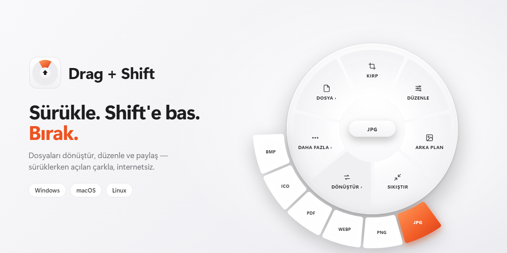

<p align="center"></p>

# Drag + Shift

Dosya yöneticisinde bir dosyayı sürüklerken **Shift**'e bas — imlecin altında bir çark açılır, dosyayı bir işlemin üstüne bırak. Sonuç orijinal dosyanın yanına kaydedilir; orijinal hiç değişmez. **Windows, macOS ve Linux** için.

## İndir

[Son sürüm](../../releases/latest) sayfasından:

| Sistem | Dosya | Not |
|---|---|---|
| **Windows 10/11** | `DragShift-Setup-x.y.z.exe` | Tek tıkla kurulur, Windows ile başlar. İmzasız olduğu için SmartScreen'de **Ek bilgi → Yine de çalıştır**. |
| **macOS** (Apple Silicon / Intel) | `DragShift-x.y.z-mac-arm64.zip` / `-mac-x64.zip` | Uygulamayı **Uygulamalar**'a taşı; ilk açılışta sağ tık → **Aç**. Cam efekti için isteğe bağlı *Ekran Kaydı* izni. |
| **Linux** (x86_64) | `.AppImage` ya da `.deb` | X11 oturumunda çalışır. Saf Wayland'da sürükleme çarkı yerine ana pencereyi kullan. |

Uygulama tepside (menü çubuğunda) durur. Tepsiye tıklayınca **ana pencere** açılır: dosya seç ya da bırak, **Dönüştür / Araçlar / Dosya** ile aynı işlemleri buradan yap; son işler listede durur.

## Kullanım

Tek tuş: **Shift** (macOS'ta da ⇧). Her dosya türünün tek bir çarkı var; **›** işaretli gruplar (Dönüştür, Daha fazla, Dosya) üzerinde biraz bekle, tekrar **Shift**'e bas ya da tıkla — seçenekleri dışarı doğru açılır.

| Dosya | Çark | Gruplar (›) |
|---|---|---|
| **Görsel** | Kırp, Düzenle, Arka plan, Sıkıştır | **Dönüştür ›** JPG, PNG, WEBP, PDF (birden fazla görsel → tek PDF), ICO, BMP · **Daha fazla ›** İşaretle, Gizle, Boyutlandır, Döndür, Çevir, Siyah-beyaz, Üstveri · **Dosya ›** |
| **PDF** | DOCX, JPG, PNG, TXT, Sayfalara ayır, Birleştir (birden fazla PDF) | **Daha fazla ›** Döndür, Üstveri temizle · **Dosya ›** |
| **Metin** (.txt, .md, .csv…) | PDF, DOCX, HTML | **Dosya ›** |
| **ZIP** | Klasöre çıkar, İçerik listesi, Optimize et | **Dosya ›** |
| **Her dosya** | | **Dosya ›** Uzantı değiştir, ZIP'le (birden fazla dosya → tek ZIP), Kopya, Hash (SHA-256/SHA-1), Base64 |

**Esc** çarkı kapatır. Çark yalnızca gerçekten dosya taşıyan bir sürüklemede görünür. Düzenleme araçları büyük bir pencerede açılır: solda önizleme, sağda ayarlar, altta **kopyayı kaydet**.

Her şey bilgisayarda, internetsiz çalışır; hiçbir dosya yüklenmez. Arayüz Türkçe (tepsi menüsünden İngilizceye geçilebilir).

## 🛡️ VirusTotal

[](https://www.virustotal.com/gui/url/fdfd91b039fa5073e3d8e8c312aed745393241d052ec25c18e9216cbbd3465a2)

Dosyalar [VirusTotal](https://www.virustotal.com) ile tarandı; hiçbir antivirüs motoru tehdit bulmadı.

| Taranan | Sonuç | Tarih | Rapor |
|---|---|---|---|
| `DragShift-Setup-1.0.2.exe` (kurulum dosyası) | **0/93** temiz | 24.10.2026 | [Raporu gör](https://www.virustotal.com/gui/url/fdfd91b039fa5073e3d8e8c312aed745393241d052ec25c18e9216cbbd3465a2) |
| Kaynak kod (`main.zip`) | **0/93** temiz | 24.10.2026 | [Raporu gör](https://www.virustotal.com/gui/url/53733cbb3bfb0aadef62d3e0e5954d3d5cdf333a34d322fbabaa5b3c944cfc98) |

## Geliştirme

```bash
npm install
npm start                 # çalıştır
npx electron . --smoke    # öz-test: gerçek dönüştürmeler + tüm çarklar + platformun girdi okuyucusu
npm run dist              # bu sistem için paket (Windows: NSIS, macOS: zip, Linux: AppImage/deb)
```

- `main.js` – tepsi, çark/araç/ana pencereleri, kayıt, otomatik başlatma.
- `input.js` – fare ve tuş durumunu yoklar: Windows `user32`, macOS CoreGraphics, Linux X11 (koffi ile; kanca ya da tuş kaydı yok).
- `index.html` – çark, ana pencere, araç pencereleri ve tüm dönüştürmeler (pdf.js, pdf-lib, jsPDF, JSZip).
- Her push'ta GitHub Actions öz-testi Windows, macOS ve Linux'ta çalıştırır; `v*` etiketi üç sistemin paketlerini sürüme ekler.

## Lisans

MIT
